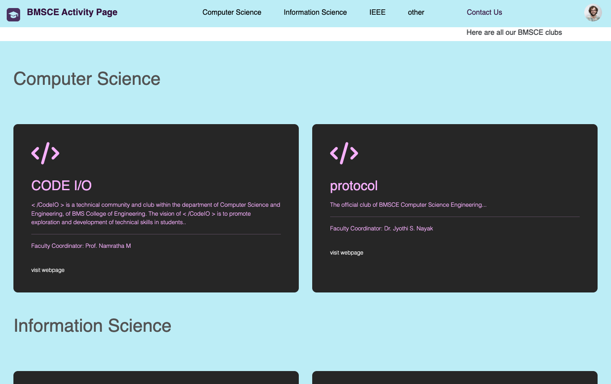
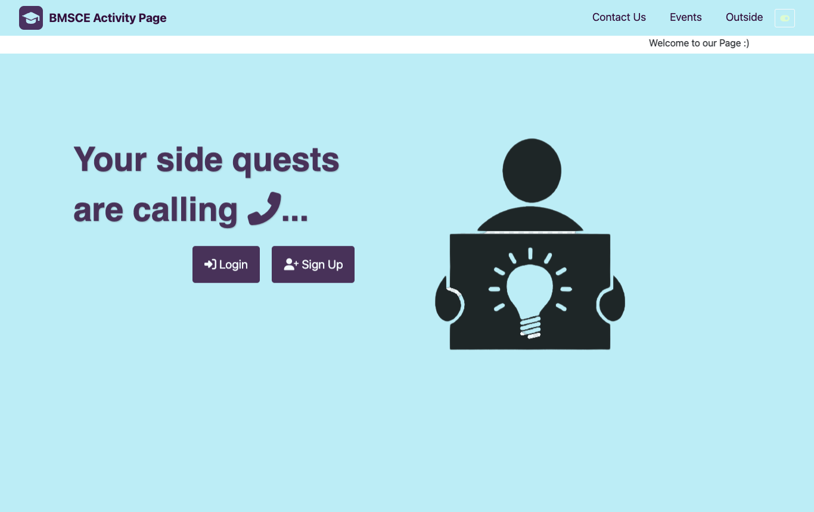
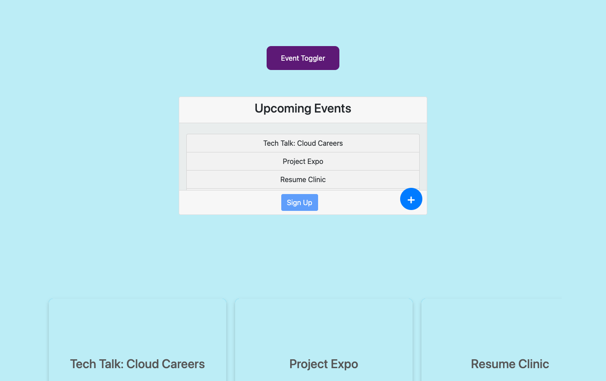
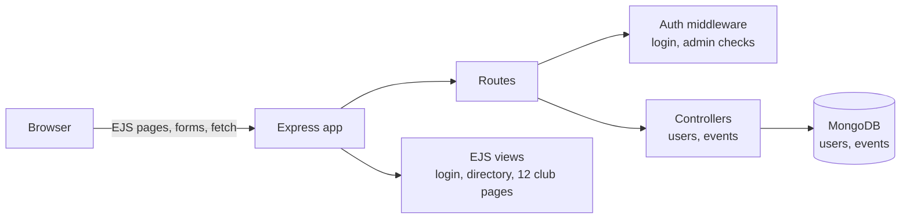

# BMSCE Club Activity Portal

A web portal for the student clubs of BMS College of Engineering. Students sign up with their college details, browse clubs by department, and view each club's events. Club admins can add and remove events, and changes are saved to MongoDB so every visitor sees them.

Built as a team project for a DevOps course, with GitHub-based collaboration (feature branches and pull requests) and continuous integration through GitHub Actions.

[](https://github.com/anaghama-beep/devops_project/actions/workflows/node.js.yml)




## Features

- **Student accounts.** Sign-up with name, college e-mail, USN and section, with client-side validation (USN format, password strength) and server-side checks. Passwords are hashed with bcrypt.
- **Session-based login.** Sessions use HTTP-only cookies, and the session ID is regenerated at login.
- **Club directory.** Clubs are grouped by department: Computer Science, Information Science, IEEE societies and others.
- **Club event pages.** Twelve club pages load their events from MongoDB and show them as a searchable list and a set of flip cards.
- **Admin event management.** Club admins can add and remove events from the club page. Admin accounts require a sign-up code set by the server, so students cannot make themselves admins.
- **Zero-setup demo.** Without a database URL, the app starts an in-memory MongoDB with sample events, so it runs with only `npm install` and `npm start`.

| Sign in | Club events (admin view) |
|---|---|
|  |  |

## Architecture



| Route | Access | Purpose |
|---|---|---|
| `GET /index` | Signed-out users | Login and sign-up page |
| `POST /index` | Anyone | Create an account (admin only with the correct code) |
| `POST /index2` | Anyone | Log in |
| `GET /secondpage`, `GET /secondpage_admin` | Signed-in users | Club directory for students and admins |
| `GET /events/:clubId` | Anyone | Club page with its events |
| `POST /events/:clubId` | Admins | Add an event |
| `DELETE /events/:clubId/:eventId` | Admins | Remove an event |
| `GET /logout` | Signed-in users | End the session |

## My contribution

I worked across the frontend and the backend, and built the club events feature end to end:

- **Backend.** I designed the `Events` schema, added the `/events/:clubId` route, and wrote the controller that loads a club's events from MongoDB and passes them to its page. I also set up the shared MongoDB Atlas database that the team developed against, including the connection setup and the user model and controller changes it required.
- **Frontend.** I built the EJS event pages for the clubs, including Code I/O, Protocol, ISE, Augment AI, IEEE CS, PES, WIE and Upagraha, and linked them from the club directory. I then removed around 5,000 lines of duplicated static HTML pages that these templates replaced.

Later, I prepared the project for this portfolio:

- **Security fixes.** I fixed three serious issues. Students could make themselves admins from the sign-up form. The login check did not stop requests for protected pages, and signed-in users got stuck in a redirect loop. The event route rendered any template named in the URL.
- **Persistent admin actions.** Adding and removing events now saves to the database instead of only changing the page.
- **Configuration and tests.** Credentials moved to environment variables. I added the in-memory demo database, integration tests and a working CI pipeline.

## Team

| Contributor | GitHub |
|---|---|
| Amshu G M | [@AmshuGM](https://github.com/AmshuGM) |
| Anagha M S | [@anaghama-beep](https://github.com/anaghama-beep) |
| Anoshor Paul | [@Anoshor](https://github.com/Anoshor) |

The original repository is [AmshuGM/devops_project](https://github.com/AmshuGM/devops_project). The full commit history is preserved here.

## Getting started

Requires Node.js 18 or later.

```bash
git clone https://github.com/anaghama-beep/devops_project.git
cd devops_project/club-portal
npm install
npm start
```

Open http://localhost:3000/index. With no database configured, the app uses an in-memory MongoDB with sample events, and data is reset when the server stops.

To use a real database and enable admin sign-up, copy `.env.example` to `.env` and set the values:

```bash
MONGODB_URI=mongodb+srv://<user>:<password>@<cluster>.mongodb.net/club_portal
SESSION_SECRET=<a long random string>
ADMIN_SIGNUP_CODE=<code that club admins enter at sign-up>
```

Run the tests, which use an in-memory database:

```bash
npm test
```

## Project structure

```
club-portal/                 the application
    app.js                   Express setup: views, static files, sessions, error handling
    index.js                 connects to MongoDB and starts the server
    config/                  environment configuration and database connection
    routes/userRoutes.js     route definitions
    middleware/auth.js       login and admin guards
    controllers/             sign-up, login, dashboards, club events
    models/userModel.js      Mongoose schemas for users and events
    data/                    club registry and demo events
    views/                   EJS templates (login, club directory, club pages)
    public/                  CSS, client-side scripts, images
    test/                    integration tests
prototypes/
    react-landing/           early React prototype of the landing page
    events-retrieval/        early experiment with event storage and retrieval
.github/workflows/           continuous integration
```

## Possible improvements

- Let students register for events inside the portal (the sign-up button currently opens an external form).
- Store sessions in MongoDB so they survive restarts and scale across instances.
- Add rate limiting on login and sign-up.
- Unify the twelve club templates into one shared layout.
